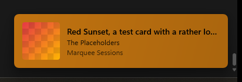
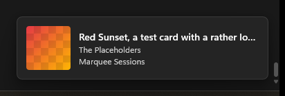
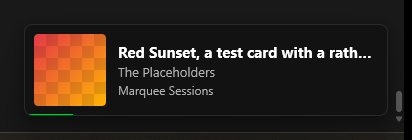
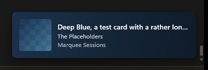

<div align="center">


### Never wonder "what song is this?" again.

A small card slides in whenever a new Spotify song starts, then slips away.
Cover, title, artist, album. Nothing more.

**Windows 10/11 · macOS 13+ · Free · No Spotify login**

[**Download**](https://github.com/hecker-01/Marquee/releases) · [How it works](#how-it-works) · [Settings](#make-it-yours)



</div>

---

## What is Marquee?

A *marquee* is the sign above a theater entrance that shows what's playing
right now. Marquee does the same for your desktop.

You're deep in your work, a song comes on, and you want to know what it is.
Normally that means finding the Spotify window. With Marquee, the answer just
appears in the corner of your screen for a few seconds and then gets out of
your way.

## Why you'll like it

- **Zero setup.** Install it, play music, done. There is no account to connect.
- **Private by design.** It never asks for your Spotify login and never talks
  to your Spotify account.
- **Looks like it belongs.** The card is built from native Windows and macOS
  parts, so it matches your system, light or dark. It is not a web page in
  disguise.
- **Feather-light.** About 7 MB of memory and practically no CPU while you
  listen.
- **Stays out of the way.** It lives in your tray (Windows) or menu bar (macOS)
  and can fade when your mouse gets close.

## Pick your look

| System | Spotify | Cover |
|:---:|:---:|:---:|
|  |  |  |
| Matches your system and follows light/dark mode | Spotify's familiar dark green style | Takes its colors from the album art |

## Get started

### Windows 10 and 11

1. Download `Marquee-<version>-x86_64.msi` from the
   [latest release](https://github.com/hecker-01/Marquee/releases).
2. Run it. Marquee installs just for you and starts right away.
3. Windows may show a "SmartScreen" warning because the app isn't signed yet.
   Click **More info → Run anyway**.

### macOS 13 and later

1. Download `Marquee-<version>.dmg`, open it, and drag Marquee into
   Applications.
2. The first time, macOS will block it because the app isn't signed yet.
   Right-click Marquee in Applications, choose **Open**, then **Open** again.

That's it. Start a song in Spotify and watch the corner of your screen.
Not sure it works? Click the Marquee icon in the tray or menu bar and press
**Test card**.

## Make it yours

Click the Marquee icon in your tray or menu bar:

| Setting | Your options |
|---|---|
| Enabled | Turn cards on or off |
| Theme | System, Spotify or Cover |
| Position | Any of the four screen corners |
| Duration | 3, 5 or 8 seconds |
| Monitor | Primary, or the one your mouse is on |
| Start at login | Have Marquee ready every time you turn on your computer |

Changes apply instantly and are remembered next time.

## How it works

Spotify already tells your computer what's playing, so other apps (like the
volume overlay) can show it. Marquee simply listens to that and shows the
card. It doesn't connect to your Spotify account, and the only thing it
downloads is the album cover (on macOS, from Spotify's public page for the
song).

Want the details? See the [technical notes](docs/TECHNICAL.md) for how the
card is drawn, exact sizes, resource measurements and known quirks.

## Good to know

- Marquee is an independent project and is **not affiliated with Spotify**. It
  uses no Spotify logo or other Spotify assets.
- Full-screen games that take over the display may draw on top of the card.
- Skipping songs can take a moment to show up, because Spotify itself reports
  changes with a small delay.
- macOS support is new and has had less real-world testing than Windows. If
  something looks off, please [open an issue](https://github.com/hecker-01/Marquee/issues).

## Build it yourself

You'll need [Rust](https://rustup.rs). Then:

```bash
cargo build --release
```

Packaging steps for the Windows installer and the macOS app, plus the
developer workflow, are in the [technical notes](docs/TECHNICAL.md).

## License

[GPL-3.0 or later](LICENSE). Made by [hecker-01](https://github.com/hecker-01).
